# Auto-Detection Flow

Each diagram shows how one subsystem of the pipeline decides what to record. [Detected Fields](../CAPABILITIES.md) lists the fields that come out, and [AIBOM Schema](schema.md) gives their shapes. The reasons and edge cases are in `IMPLEMENTATION_NOTES.md`, in the sections listed under each heading.

In the precedence chains (`A → B → C`), the first source that yields a value wins. An `aibom.io/*` annotation wins over detection for nearly every field.

## Overview

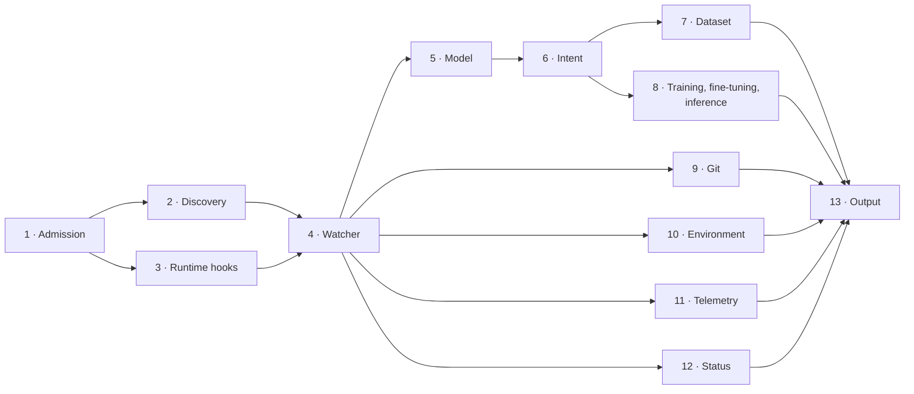

## 1 · Admission

The webhook decides which pods to instrument and what to inject into them. *Notes: Pod Matching and Injection; `aibom.io/postprocess-for` Trust Boundary.*

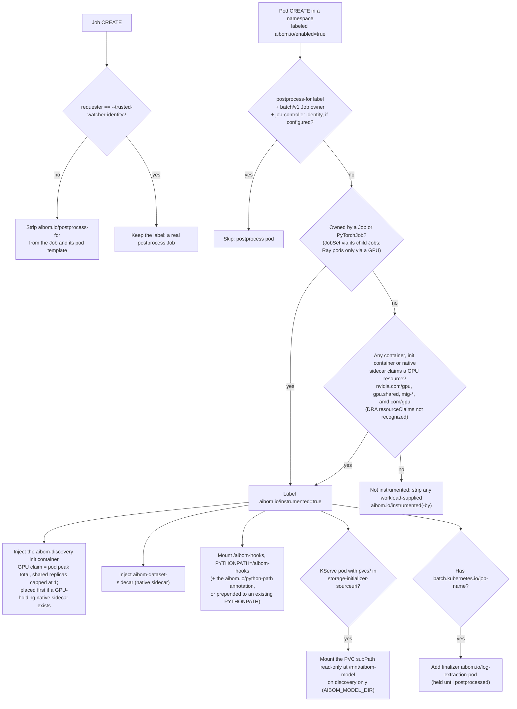

## 2 · Discovery init container

The discovery init container (`generate_snapshot.py`) records the hardware and the model's storage once, at pod startup. Each stage runs under a 60 s deadline, and a stage that fails or times out logs a warning instead of failing the pod. *Notes: Discovery Init Container Fails Open; AMD; Model Auto-Detection (KServe storage); Discovery Data Signing.*

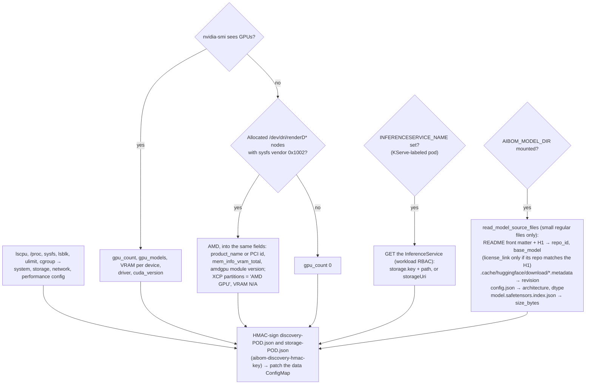

## 3 · Runtime hooks

`runtime_detector.py` runs as `sitecustomize` in every Python process in the app container. *Notes: How the hooks get installed; Runtime Detection Output Durability; Determinism; DataLoader Sampling; Optimizer and Scheduler; Numerical Precision; Distributed Topology; Software Versions; Dataset Declaration and Reconciliation; Git Provenance Detection.*

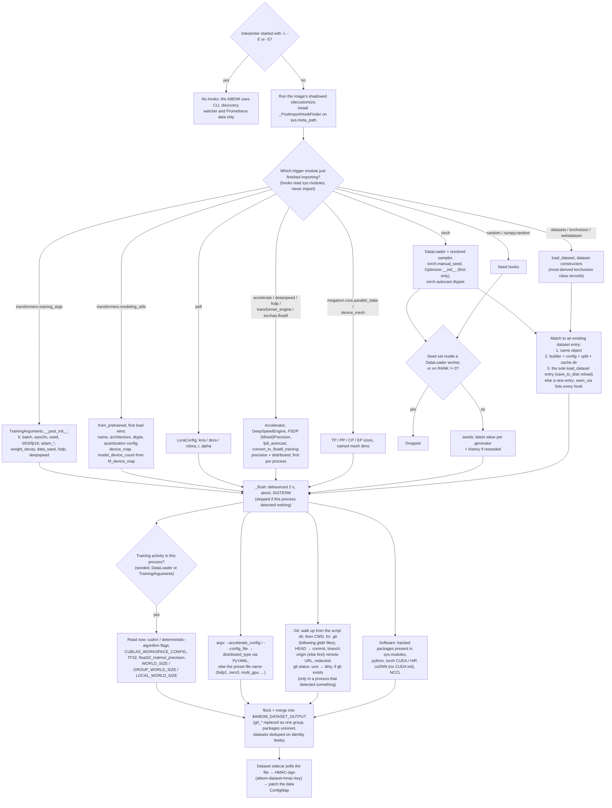

## 4 · Watcher

The watcher decides when to postprocess a workload and what to hand the postprocess Job. *Notes: Workload Selection and Grouping; Stale Finalizers; Job Pods Held Until Postprocessed; Postprocess Flow.*

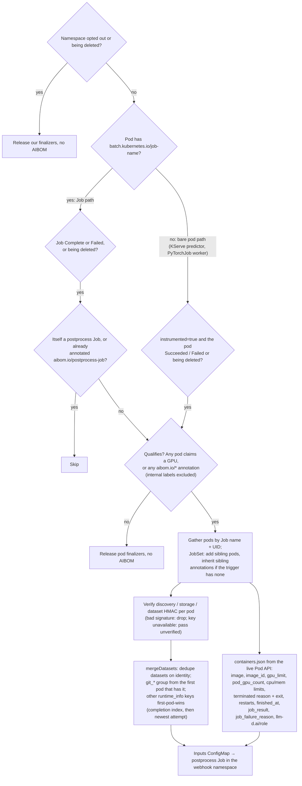

## 5 · Model

*Notes: Model Auto-Detection.*

### Container commands

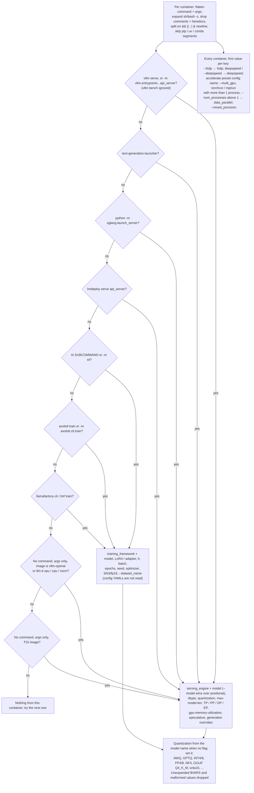

### KServe storage

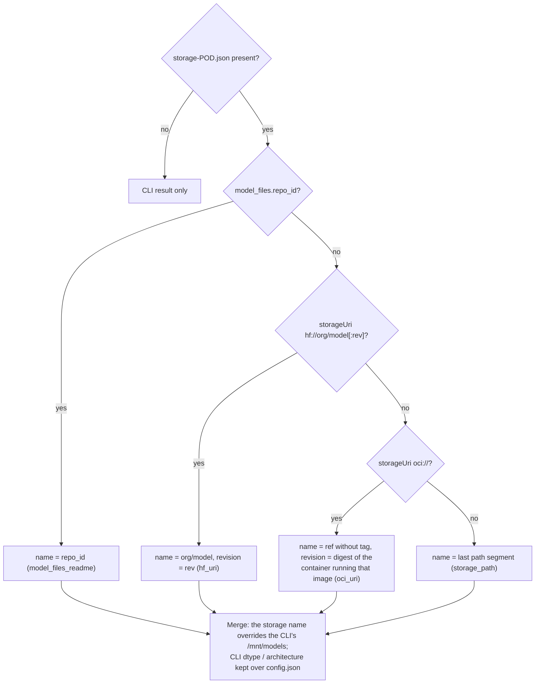

### Field precedence

`detected` is the merged result of the two diagrams above, and `hook` is the `from_pretrained` or TrainingArguments runtime hook. If the `aibom.io/model-name` annotation names a different model, postprocess drops `revision`, `base_model`, and `size_bytes`.

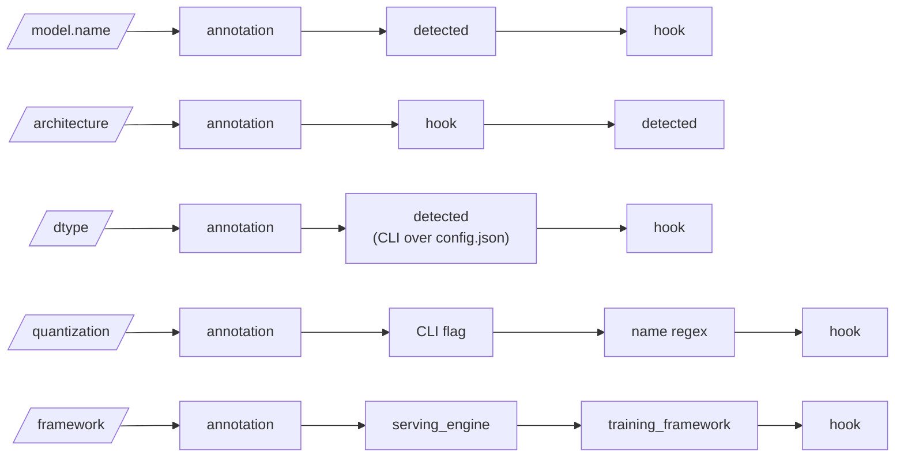

## 6 · Experiment intent

Intent decides which sections the AIBOM gets, so a wrong intent drops whole sections. *Notes: Experiment Intent Detection.*

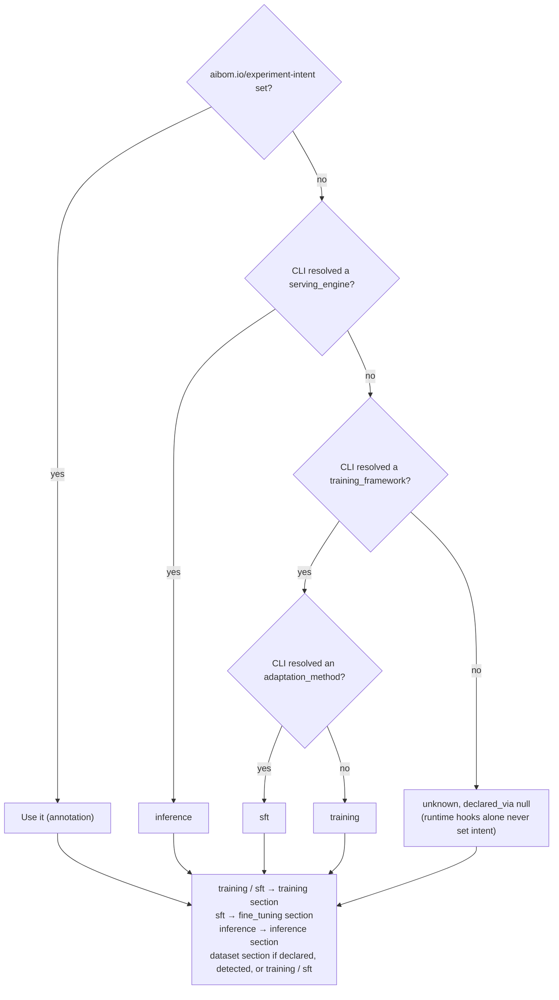

## 7 · Dataset

*Notes: Dataset Declaration and Reconciliation.*

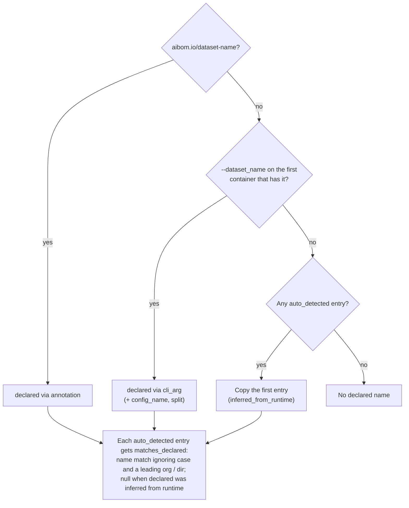

## 8 · Training, fine-tuning, and inference

The AIBOM has each of these sections only for the intents named in its heading. *Notes: Determinism; Optimizer and Scheduler; Numerical Precision; Distributed Topology; Model Auto-Detection (parallelization, and the vLLM and trl flag tables).*

### Training (intent `training` or `sft`)

`hook` is the TrainingArguments runtime hook unless named otherwise.

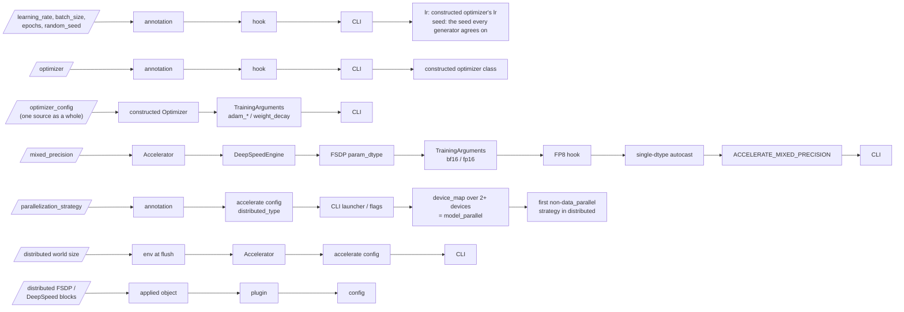

`determinism` (seeds and flags) and `precision` (TF32, autocast, FP8, FSDP, DeepSpeed) come only from the runtime hooks.

### Fine-tuning (intent `sft`)

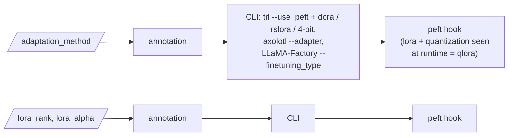

### Inference (intent `inference`)

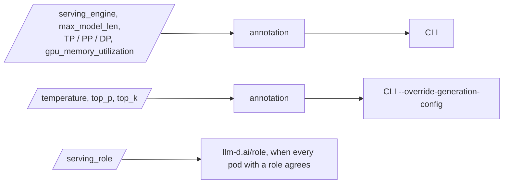

Postprocess reads only the server's startup command, so it never sees sampling parameters that a client sends with each request.

## 9 · Git provenance

*Notes: Git Provenance Detection.*

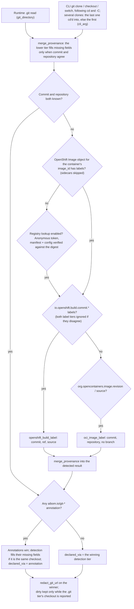

## 10 · Environment

*Notes: Discovery Data Signing (multi-pod `environment`, typed values); Which resources count as GPUs; Software Versions.*

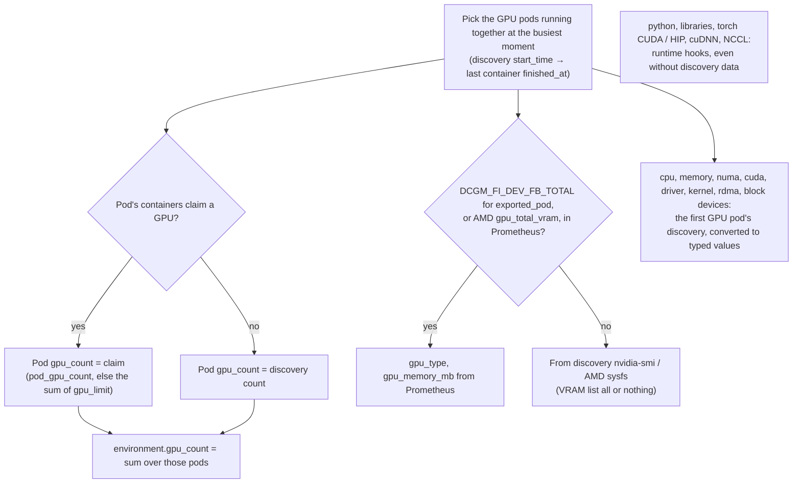

## 11 · Telemetry

*Notes: Prometheus Telemetry; Telemetry Retries; Segmented Performance Stats; Telemetry Time Series; Inference Performance Telemetry.*

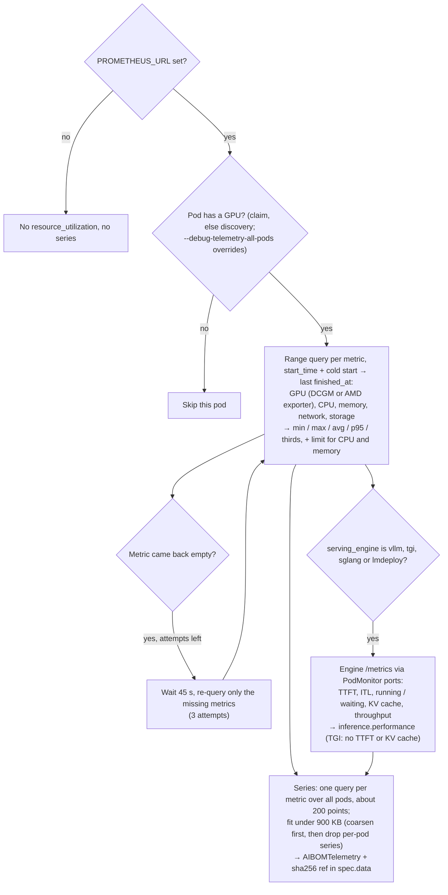

## 12 · Execution status

*Notes: Pod Termination Status.*

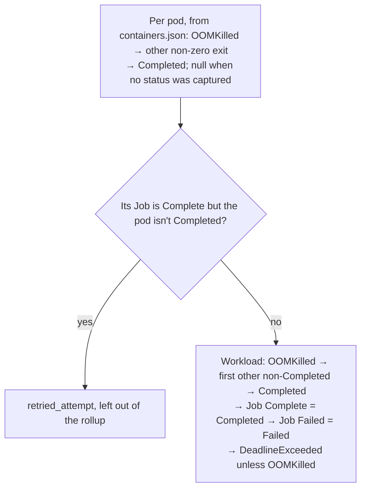

## 13 · Output

*Notes: Compiled AIBOM Signing; Telemetry Time Series.*

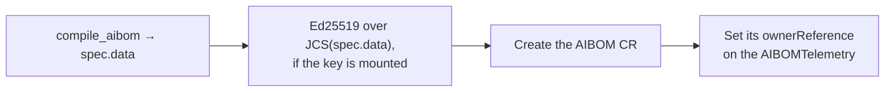
